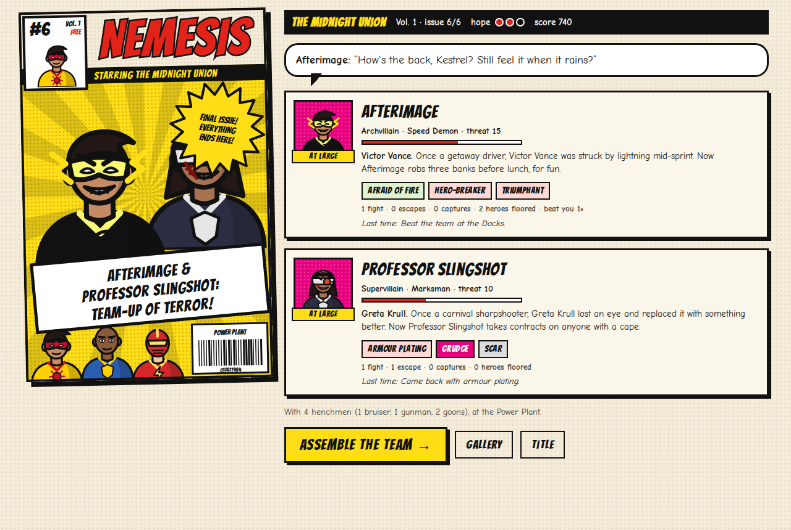
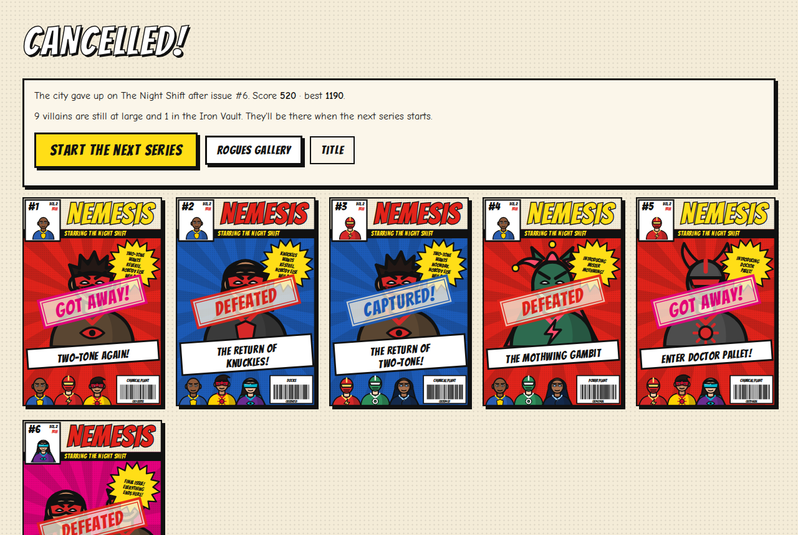
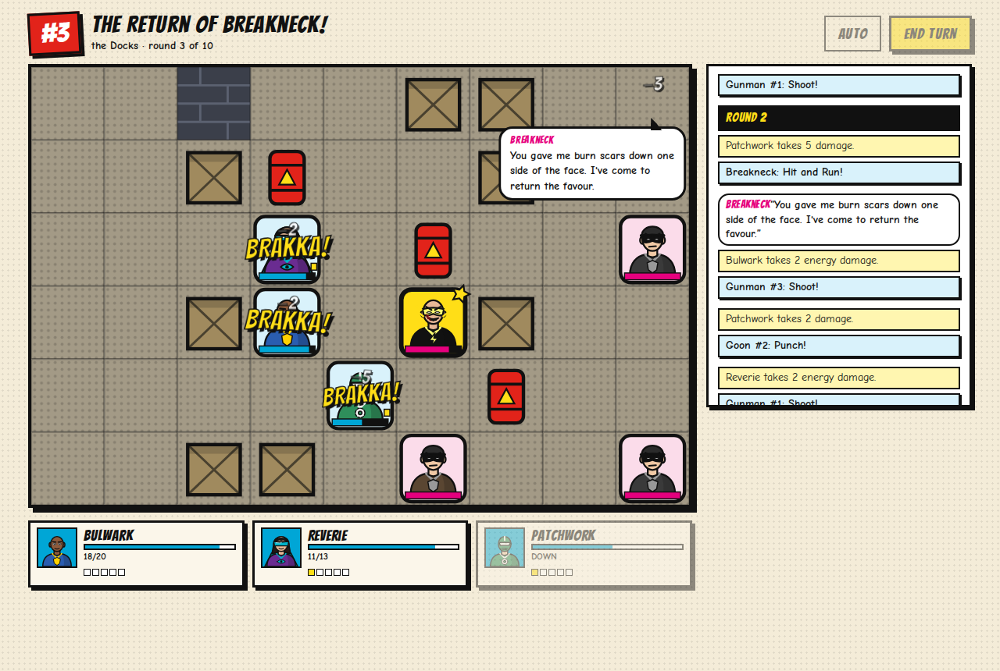
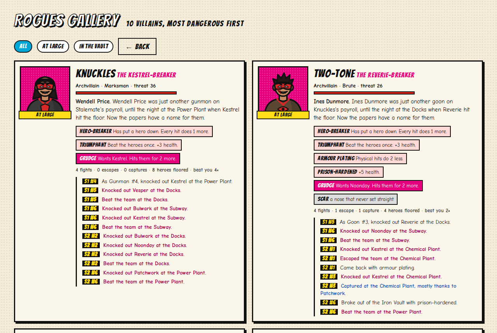

<h1 align="center">Nemesis</h1>

<p align="center">
  <b>A superhero tactics game told as a comic series.</b><br>
  Every fight is an issue with its own cover. The villains you fail to stop come back stronger, hold a grudge
  against the hero who hurt them, and remember where you met. A nameless goon who knocks out a hero gets a name
  of their own.
</p>

<p align="center">
  
</p>

**Live:** https://ardakalper.github.io/nemesis/

## The game

- **A series is six issues.** Each issue is one fight on a 9×6 grid. Pick three of your six heroes. Lose a fight
  and the city's hope drops; at zero the series is cancelled.
- **Six heroes, six ways to fight.**
  - Bulwark the brick knocks foes into walls.
  - Kestrel the speedster dashes across the room.
  - Noonday the blaster sets things on fire.
  - Reverie the mentalist stuns.
  - Patchwork the gadgeteer tags villains so they can't run, and deploys turrets.
  - Vesper the mystic shields and heals.
- **Tactics.**
  - Walls block movement and sight, crates give cover, and barrels explode in chains.
  - Hits build momentum, which pays for signature moves.
  - Two heroes standing side by side can team up: Human Cannonball, Blinding Flash, Tag and Bag, Guardian
    Strike.
- **Capture, don't kill.** At 30% health a villain tries to run unless they are stunned or tagged. After ten
  rounds they get away anyway.
- **Between issues**, heroes level up, nurse injuries and train (tougher, faster, stronger, fired up, practised).

## The nemesis system

Villains are never thrown away. They live in a rogues gallery that outlasts every series, and what happens in a
fight changes them:

| What happened | What it does to them |
| --- | --- |
| They escaped or beat you | They **adapt**: they now resist the damage type that hurt them most, and the matching weakness is gone. They hold a **grudge** against the hero who did the most damage and hit that hero for 2 more. They **scar**. |
| They keep coming back | They rise in **rank** (lieutenant, supervillain, archvillain) and get tougher every time. |
| You captured them | They go to the Iron Vault. After at least one issue inside, the walls start leaking. A **breakout** makes them prison-hardened, then cybernetic, and earns them the epithet "Unchained". |
| A henchman knocked out a hero | The henchman is **promoted**: a nickname, an epithet ("Knuckles, the Kestrel-Breaker"), an origin, and a grudge against that hero. |
| It's the finale | Your worst nemesis comes back for it, even from prison, with a second villain at their side. |

The game writes all of this down: the villain's history, issue titles ("The Return of Two-Tone!", "Who Is
Knuckles?"), cover blurbs ("PROFESSOR SLINGSHOT WANTS KESTREL. NOBODY ELSE WILL DO.") and taunts that remember where you
met. Every finished issue files a cover, stamped CAPTURED!, GOT AWAY! or DEFEATED, and any cover saves as a PNG.

<p align="center">
  
</p>

<p align="center">
  
</p>

<p align="center">
  
</p>

## How it works

The game is plain C# with no dependencies. The browser version runs that same code in WebAssembly through Blazor.

| Part | How |
| --- | --- |
| Determinism | xorshift128+ seeded through splitmix64, with labelled forks for each part of an issue. The same seed always gives the same series, so the tests can play whole campaigns and compare them. |
| Maps | Crates, walls and barrels are scattered by place (the Docks get more crates, the Chemical Plant more barrels). A flood fill rejects any map that cuts a tile off. |
| Rules | BFS movement, Bresenham line of sight and Chebyshev range. Damage is deterministic: resistances halve it, weaknesses add half, and tags, cover, armour and grudges add or subtract a little. |
| AI | Utility scoring. For every tile a villain can reach, it scores every power aimed at every target. Damage that lands, finishing someone off, a grudge target, stuns, tags and burns all count. Ranged villains don't like standing next to heroes. The same AI plays the heroes on Auto. |
| Nemesis system | `Rivalry.Aftermath` reads the fight's damage log (who hurt whom, with what) and rewrites the villain: traits, grudge, scars, rank, history. `Campaign.Plan` picks who comes back, weighted by how much of a nemesis each villain has become. |
| Replays | The rules emit an event log. The UI snapshots the board before a turn, then replays the events one by one: tokens slide, sound effects pop, numbers float and villains talk. Click to skip. |
| Art | Every hero, villain and goon is a procedural SVG bust built from a few parameters: colours, mask, hair, emblem, cape and an extra (horns, flame hair, a brain dome…). Covers are SVG too. For the PNG export, the halftone pattern and the Bangers font are inlined into the SVG before it is drawn to a canvas. |
| Saving | The universe (rogues gallery, covers, current series) is serialised with System.Text.Json into localStorage. |

## Using the core in Unity

`src/Nemesis.Core` targets .NET Standard 2.1 with C# 9 and has no dependencies, so its files drop into a Unity
project as they are (or build the DLL and put it in `Assets/Plugins`).

```csharp
using System.Linq;
using Nemesis;

var universe = new Universe();
var series = Campaign.NewSeries(universe, seed: 42, teamName: "The Night Shift");
var battle = Campaign.StartBattle(universe, series, new[] { "bulwark", "kestrel", "vesper" });

var hero = battle.Heroes.First();
var boss = battle.Bosses.First();
battle.MoveUnit(hero, new Pos(2, 2));           // false if the tile is out of reach
battle.UsePower(hero, "haymaker", boss.Pos);    // or let the AI play the turn: battle.AutoHeroTurn()
battle.EndHeroTurn();                           // the villains play

foreach (var e in battle.Log)
{
    var line = Narration.Caption(battle, e);    // "Bulwark: Haymaker!", "Breakneck is out cold!"…
    if (line != null) Debug.Log(line);
}

var notes = Campaign.Finish(universe, series, battle);  // the nemesis system runs here
```

## Project layout

```
src/Nemesis.Core     the game: rules, AI, content, nemesis system, campaign (netstandard2.1)
src/Nemesis.Web      the Blazor WebAssembly front end: board, covers, figures, screens
tests/Nemesis.Tests  xUnit: rules, nemesis system, campaigns, determinism, saving, balance
e2e                  Playwright: plays issues in a real browser, checks saving and the phone layout
```

## Run it

Needs the .NET 8 SDK (and Node for the browser tests).

```sh
dotnet test                                   # unit tests
dotnet run --project src/Nemesis.Web          # play at the URL it prints

dotnet publish src/Nemesis.Web -c Release -o publish
cd e2e && npm ci && npx playwright install chromium && npx playwright test
```

Every push to `main` runs both test suites and publishes `publish/wwwroot` to GitHub Pages.

## License

MIT. Fonts: [Bangers](https://fonts.google.com/specimen/Bangers) and
[Comic Neue](https://fonts.google.com/specimen/Comic+Neue), both under the SIL Open Font License
(see `src/Nemesis.Web/wwwroot/fonts`).
